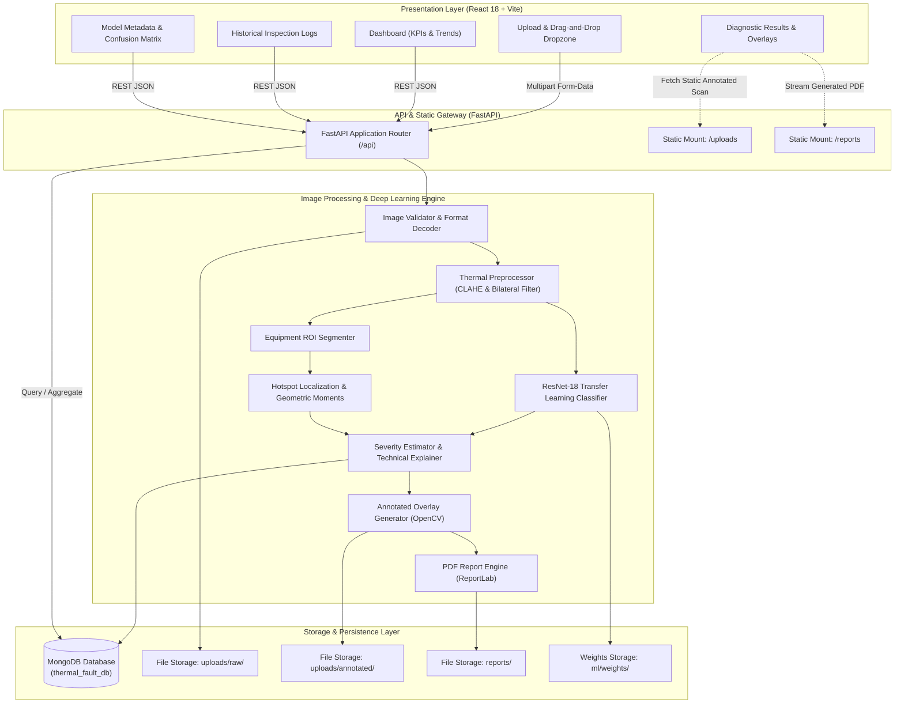

# System Architecture: Deep Learning-Based Thermal Fault Detection

## 1. High-Level Architectural Overview

The system is designed as a modern, decoupled three-tier architecture comprising:
1. **Presentation Layer (Frontend):** React.js + Vite + Tailwind CSS dashboard providing real-time upload, dual-view thermographic visualization, metric cards, and report retrieval.
2. **Application & Processing Layer (Backend):** Python FastAPI asynchronous server coordinating image validation, OpenCV image enhancement, PyTorch transfer-learning inference, hotspot segmentation, and ReportLab PDF compilation.
3. **Data & Persistence Layer:** MongoDB document database persisting image metadata, bounding coordinates, probability distributions, and analysis history.

---

## 2. Layer Responsibilities & Design Decisions

### Presentation Layer (React.js)
- Responsive, dark-mode engineering dashboard with high contrast suited for industrial environments.
- Drag-and-drop dropzone supporting PNG, JPG, JPEG, TIFF, and BMP with instantaneous client-side validation.
- Interactive dual thermographic visualization: switch between raw radiometric image, AI diagnostic overlay, and side-by-side comparison.
- Real-time MongoDB connectivity health badge and background heartbeat polling every 15 seconds.
- Quick-load benchmark scans allowing immediate verification across all 5 fault categories.

### Processing & Machine Learning Layer (FastAPI & PyTorch)
- **FastAPI:** High performance asynchronous ASGI web framework with automatic OpenAPI documentation.
- **OpenCV Pipeline:**
  - Converts false-color palettes (ironbow, jet, inferno) into normalized thermal intensity maps.
  - Applies edge-preserving bilateral filtering to cancel high-frequency sensor noise.
  - Applies Contrast Limited Adaptive Histogram Equalization (CLAHE) to reveal low-temperature delta gradients.
  - Segment equipment bodies from ambient background using Otsu thresholding and morphological closing.
  - Computes statistical thermal thresholding to isolate hotspots, calculating bounding box $[x_{min}, y_{min}, x_{max}, y_{max}]$, centroid $[c_x, c_y]$, peak pixel $[p_x, p_y]$, area ratio, and relative contrast.
- **PyTorch CNN:** ResNet-18 backbone fine-tuned for 5 thermal conditions (`Normal`, `Overheating`, `Electrical Fault`, `Insulation Fault`, `Abnormal Hotspot`).
- **ReportLab:** Dynamically renders downloadable multi-page engineering inspection reports.

### Database Layer (MongoDB)
- Persists decoupled file references, timestamped records, bounding coordinates, and classification logits.
- Handles connection dropouts strictly: returns explicit HTTP 503 diagnostics rather than pretending records saved.
