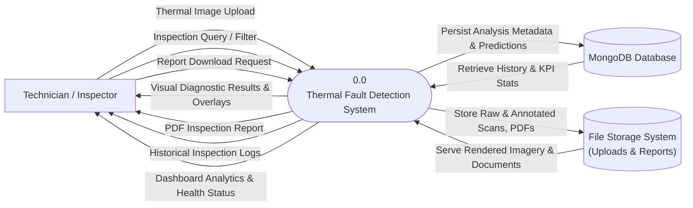
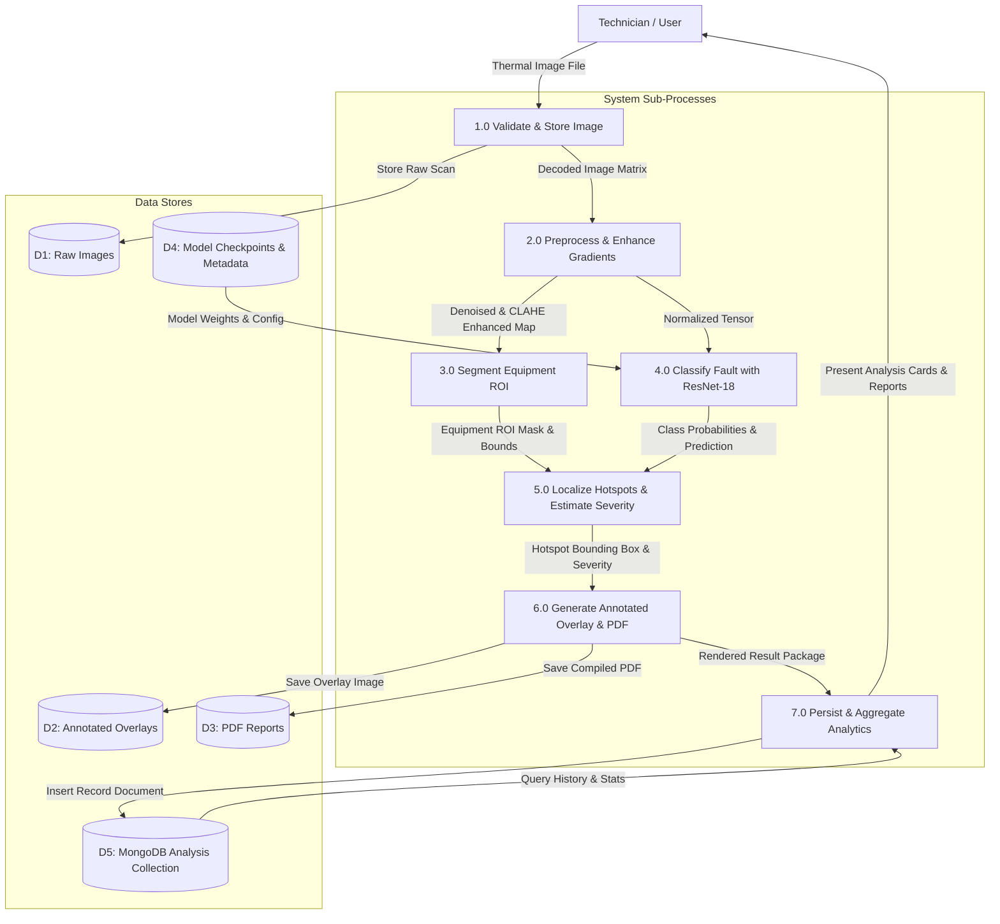

# Data Flow Diagrams (DFD): Deep Learning-Based Thermal Fault Detection

## 1. DFD Level 0: Context Diagram

The Level 0 context diagram defines the boundary of the thermal inspection system, showing external entities and primary information exchanges.

---

## 2. DFD Level 1: Data Flow Diagram

The Level 1 DFD decomposes the system into discrete sub-processes, identifying internal data stores and data transformations.

