# System Flowchart: Deep Learning-Based Thermal Fault Detection

This flowchart details the required system workflow, tracing the path from raw thermal image capture through the decision logic of Normal vs Fault Detected conditions.

```mermaid
flowchart TD
    Start(["Start"]) --> Input["Thermal Image Input\n(Capture or Drag-and-Drop Upload)"]
    Input --> Validate{"Image Validation\n(Format, Dimensions & Integrity)"}

    Validate -->|Invalid Format or Corrupt| ErrMsg["Return HTTP 400 Bad Request\nwith Remediation Guidance"] --> EndFailed(["Termination (Error Handled)"])

    Validate -->|Valid Image| Preproc["Image Preprocessing\n- Denoise: Bilateral Filter\n- Enhance: CLAHE Contrast\n- Resizing & Tensor Normalization"]

    Preproc --> ROIDetect["Equipment ROI Detection\n- Otsu Multi-thresholding\n- Morphological Closing\n- Equipment Boundary Segmentation"]

    ROIDetect --> DLInference["Deep Learning Model (ResNet-18)\n- Forward Pass Feature Extraction\n- 5-Way Softmax Probability Calculation"]

    DLInference --> HotspotScan["Abnormal Thermal Pattern Detection\n- Percentile Thresholding\n- Peak Gradient Extraction\n- Hotspot Localization & Moments"]

    HotspotScan --> Decision{"Decision:\nFault Detected?"}

    %% BRANCH: NO (Normal Condition)
    Decision -->|NO| Norm_Status["Display Normal Condition (Safe / Green)"]
    Norm_Status --> Norm_Result["Show Analysis Result\n- Equipment Operating Within Thermal Limits\n- Confidence Score & Baseline Metrics"]
    Norm_Result --> Norm_Report["Generate PDF Inspection Report\n(Indicating No Fault Detected & Routine Patrol Recommendation)"]
    Norm_Report --> Complete(["Result Generation & Completion"])

    %% BRANCH: YES (Fault Detected)
    Decision -->|YES| Fault_Class["Classify Fault Category\n- Overheating\n- Electrical Fault\n- Insulation Fault\n- Abnormal Hotspot"]
    Fault_Class --> Fault_Locate["Locate Hotspot & Fault Region\n- Bounding Box [x_min, y_min, x_max, y_max]\n- Centroid [cx, cy]\n- Peak Intensity Pixel [px, py]"]
    Fault_Locate --> Fault_Sev["Estimate Fault Severity\n(Low, Medium, or High based on Contrast Ratio & Geometry)"]
    Fault_Sev --> Fault_Conf["Calculate Model Confidence Score & Class Probabilities"]
    Fault_Conf --> Fault_Overlay["Display Fault Location on Image\n(Generate Visual Overlay with Equipment ROI & Hotspot Vectors)"]
    Fault_Overlay --> Fault_Report["Generate Final Diagnostic PDF Fault Report\n(With Recommendations, Imagery, Coordinates & Disclaimer)"]
    Fault_Report --> Complete

    Complete --> DB_Persist[("Persist Metadata & Results\nto MongoDB Database")]
    DB_Persist --> EndSuccess(["End / Display in Dashboard & History"])
```

---

## Workflow Step Explanations

1. **Input & Validation:** Uploads are checked for format (`.png`, `.jpg`, `.jpeg`, `.tiff`, `.bmp`), maximum size ($\le 15\text{ MB}$), and decoded dimensions ($\ge 32\times 32\text{ px}$).
2. **Preprocessing:** Noise is suppressed while maintaining steep thermal edges using bilateral filtering. Contrast is equalized using CLAHE.
3. **Equipment ROI:** Contours are isolated to ensure background cooler surfaces do not skew thermal distribution metrics.
4. **ResNet-18 Classification:** Image features are processed through deep convolutional layers to predict fault class probabilities.
5. **Decision Branching:**
   - **Normal Branch:** Evaluates if no hotspot was segmented and classification confirmed Normal. Prepares a clearance report.
   - **Fault Detected Branch:** Calculates precise pixel coordinates, computes thermal contrast percentage, assigns a severity score (Low/Medium/High), annotates the image, and compiles an actionable engineering report.
