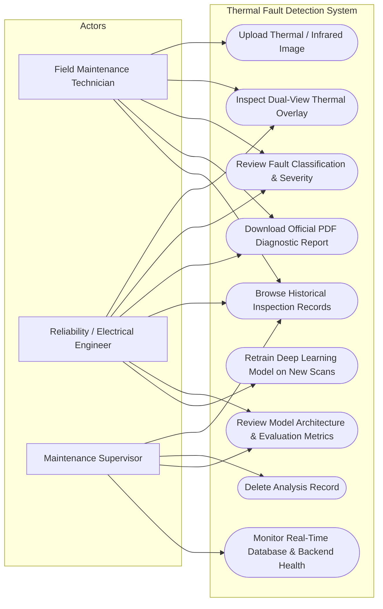
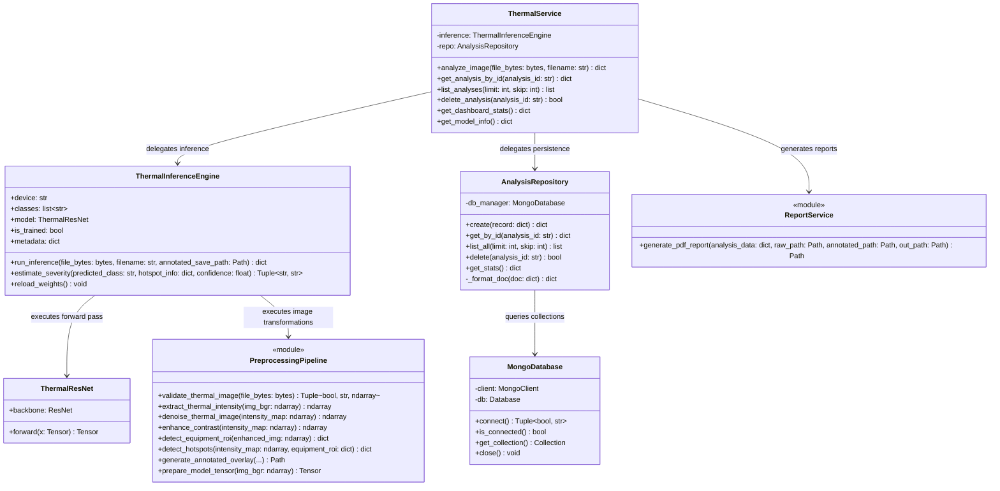
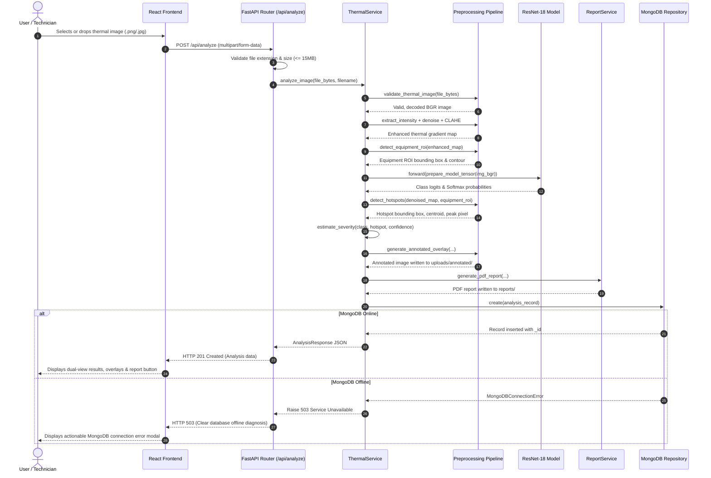

# UML System Diagrams: Deep Learning-Based Thermal Fault Detection

## 1. UML Use-Case Diagram

---

## 2. UML Class Diagram

This diagram reflects the actual Python classes and relationships implemented in the codebase.

---

## 3. UML Sequence Diagram: End-to-End Analysis Workflow

